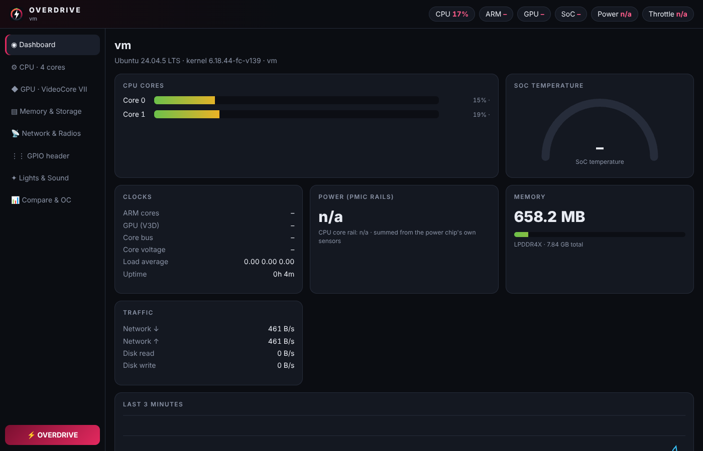
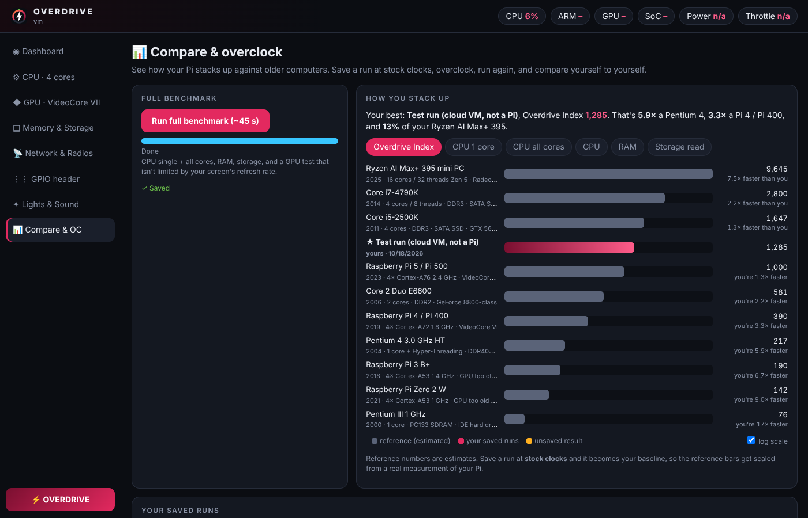
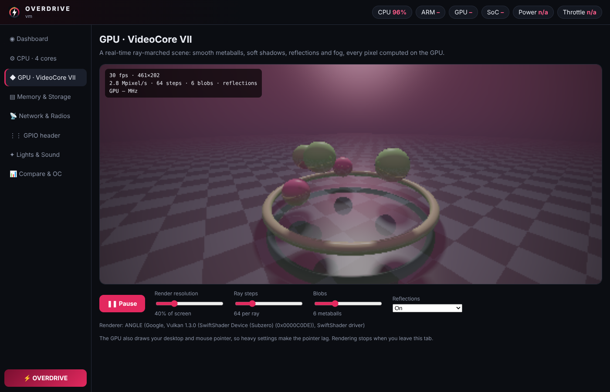

# ⚡ Overdrive

A hardware showcase for the **Raspberry Pi 500** (works on any Pi 5-family board).
One dashboard that lights up every part of the machine — and an **Overdrive** button that pushes it all at once and gives you a score.



| Section | What it drives |
|---|---|
| **Dashboard** | Live per-core load and clocks, SoC temperature gauge, ARM / GPU / bus clocks, core voltage, **real power draw from the PMIC**, throttle flags, RAM, network + disk traffic, displays, USB devices, 3-minute history graph |
| **CPU** | Single-core sprint, then all 4 Cortex-A76 cores in parallel processes; shows scaling and per-core scores |
| **GPU** | WebGL2 ray-marcher on the VideoCore VII: metaballs, soft shadows, ambient occlusion, reflections, fog. Sliders for resolution, ray steps, blob count |
| **Memory & Storage** | RAM vs cache copy bandwidth, sequential read/write and random 4K reads on your SD/NVMe, drive list |
| **Network & Radios** | Animated Wi-Fi radar (2.4 vs 5 GHz), Bluetooth/BLE scan with RSSI, router + internet ping, download speed, Ethernet link |
| **GPIO** | Live 40-pin header diagram via `pinctrl`; click a pin to see it, unlock to drive outputs |
| **Lights & Sound** | Every kernel LED incl. keyboard lock lights, a light show, a Web Audio synth with spectrum + scope, keyboard visualizer |
| **📊 Compare & OC** | Full benchmark (CPU, RAM, storage, refresh-rate-free GPU test) that you can save and name. Compares you against a Pentium III, Pentium 4, Core 2 Duo, i5-2500K, i7-4790K, Pi 3, Pi 4/400, Pi Zero 2, Pi 5 and a Ryzen AI Max+ 395. Shows saved runs with +/-% against your stock baseline, plus one-click overclock presets (Stock / Mild / Spicy / Max) |
| **⚡ Overdrive** | 20 s of all cores + max-detail GPU + LED strobe, then a memory blast → report card with peak temp, watts, clocks and a score |

## Screenshots
| Compare & overclock | GPU ray-marcher |
|---|---|
|  |  |

*Screenshots were taken on a test machine, not a Pi. On a Pi 500 the temperature, clock, power and GPIO readings fill in.*

## Install
```bash
unzip overdrive.zip && cd overdrive
./install.sh
```
Adds a desktop icon and a menu entry (System Tools). The installer asks once for sudo to unlock the LEDs and GPIO; say no and everything else still works.

## Run without installing
```bash
python3 overdrive.py              # opens a Chromium app window
python3 overdrive.py --kiosk      # full screen
python3 overdrive.py --lan        # also view it from your phone/PC at http://<pi-ip>:8500
```
Python standard library only — nothing to pip install. The server quits by itself a couple of minutes after you close the window.

## Overclock & compare workflow
1. **Compare & OC → Run full benchmark** at factory clocks → save as "Stock". Your first saved run becomes the ★ baseline, and the reference machines get scaled from it.
2. Pick a preset (asks for your password), then reboot.
3. Run the full benchmark again and save it. The runs table shows +/-% for every score, the peak clocks, the peak temperature and whether it throttled.
4. Saved runs live in `~/.config/overdrive/runs.json`. Presets go in a marked block at the end of `/boot/firmware/config.txt`, with a backup at `config.txt.overdrive-bak`.

**If an overclock won't boot:** put the SD card in another computer, open the *bootfs* drive, and delete the lines between `# >>> Overdrive OC >>>` and `# <<< Overdrive OC <<<` in config.txt.

## Notes
- Reference-machine numbers are estimates based on published performance ratios. Your own runs are real measurements.
- The GPU tab starts paused: the GPU also draws your desktop, so heavy settings make the mouse pointer lag.
- Power figures are the sum of the PMIC's rail sensors (SoC + RAM + I/O), not wall power.
- The Pi 500 is passively cooled — watch the temperature climb in Overdrive mode.
- Storage test writes a temporary file in your home folder and deletes it.
- Uninstall: `./uninstall.sh` (`--all` also removes the LED rule).

## Download
Grab the code from this repo (Code → Download ZIP), unzip it on the Pi, then run `./install.sh`.
